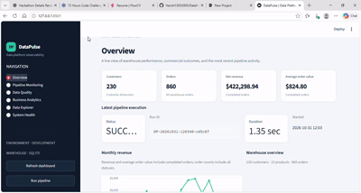
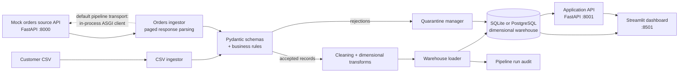
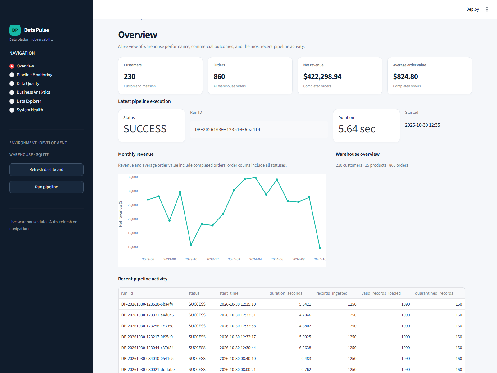
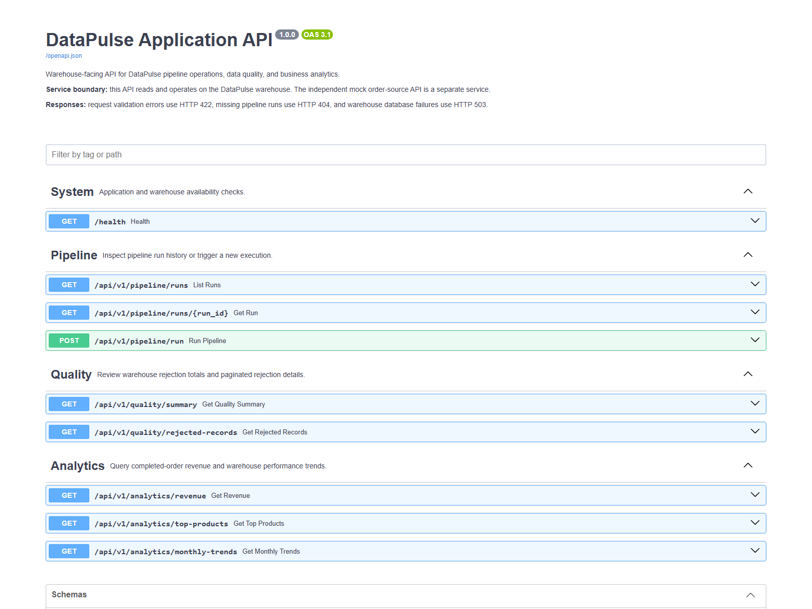

# DataPulse

<p align="center">
  
</p>

<p align="center">
  <strong>From raw customer and order data to a validated, observable analytics warehouse.</strong>
</p>

**A local-first data engineering and analytics platform for e-commerce pipeline observability.**

DataPulse ingests customer records from CSV and order transactions from a paginated
mock REST source, validates and transforms the data, loads a dimensional warehouse,
and exposes pipeline, quality, and business analytics through a FastAPI application
API and a Streamlit dashboard.

> DataPulse is an engineering demonstration and learning project. It is not a
> production-hardened hosted service. This repository documents the behavior that
> is implemented and tested; deployment, security, and scale claims should be
> evaluated against your own environment.

[Quick start](#quick-start) · [Architecture](#architecture) · [Railway deployment](#railway-deployment) · [Docker Compose](#docker-setup) · [Tests](#automated-tests)

## Contents

- [Business problem](#business-problem)
- [Objectives](#project-objectives)
- [Features](#key-features)
- [Technology](#technology-stack)
- [Quick start](#quick-start)
- [Architecture](#architecture)
- [Data flow](#data-flow)
- [Dimensional model](#dimensional-model)
- [Repository structure](#folder-structure)
- [Prerequisites and installation](#prerequisites)
- [Environment setup](#environment-setup)
- [Database initialization](#database-initialization)
- [Synthetic data generation](#synthetic-data-generation)
- [Docker setup](#docker-setup)
- [Pipeline execution](#pipeline-execution)
- [API startup](#application-api-startup)
- [Dashboard startup](#dashboard-startup)
- [Railway deployment](#railway-deployment)
- [Tests](#automated-tests)
- [Performance benchmark](#performance-benchmark)
- [Sample analytical results](#sample-analytical-results)
- [Data quality and reconciliation](#data-quality-and-reconciliation)
- [Screenshots](#screenshots)
- [Limitations and future work](#known-limitations-and-future-improvements)
- [Detailed documentation](#detailed-documentation)

## Quick start

The local workflow uses SQLite and does not require Docker or a public API.
Run these commands from the repository root in PowerShell:

```powershell
py -3.12 -m venv .venv
.\.venv\Scripts\Activate.ps1
python -m pip install -r requirements.txt
python scripts/generate_seed_data.py
python scripts/run_pipeline.py
```

After the pipeline completes, start the warehouse API and dashboard in separate
terminals from the repository root:

```powershell
python main.py --api
```

```powershell
streamlit run dashboard/app.py
```

Open the [warehouse API documentation](http://127.0.0.1:8001/docs) or the
[DataPulse dashboard](http://localhost:8501). The default pipeline uses the
mock order source in-process; starting the separate source API is optional:

```powershell
python main.py --source-api
```

For PostgreSQL, Docker Compose, or Railway deployment, see the corresponding
sections below. Check the current environment and database connection with
`python main.py --health`.

## Business problem

Order and customer information commonly arrives through different interfaces and
at different levels of detail. Teams need to identify malformed or referentially
invalid records, understand pipeline outcomes, and query consistent business
metrics without manually reconciling source files and transactions.

DataPulse demonstrates a single local workflow for those concerns: retain source
context, validate inputs, route failures for inspection, load a relational
dimensional model, and make warehouse and run data accessible through an API and
dashboard.

## Project objectives

- Provide a repeatable example of a CSV plus REST-style ingestion workflow.
- Separate source ingestion, validation, transformation, persistence, API, and
  presentation responsibilities.
- Preserve validation failure details for review rather than silently discarding
  them.
- Track pipeline executions and expose warehouse-based analytics.
- Keep development and tests runnable without a public API.
- Record repeatable benchmark measurements and document their limits.

## Key features

- Customer CSV ingestion with row metadata and record hashes.
- Paginated order-source ingestion, including an in-process mock ASGI transport.
- Pydantic input validation, domain checks, referential checks, and quarantine
  utilities.
- Deterministic dimensional transformations and idempotent warehouse loading
  with shared namespaced surrogate-key generation for customer, product, and
  order keys across loader paths.
- SQLite for local development and PostgreSQL for Docker Compose or Railway.
- Warehouse application API with interactive Swagger UI.
- Streamlit sections for Overview, Pipeline Monitoring, Data Quality, Business
  Analytics, Data Explorer, and System Health.
- Per-test isolated SQLite databases and deterministic Pytest fixtures.
- A benchmark comparing the previous row-by-row warehouse loading path with
  bounded batched lookups.

## Technology stack

| Area | Technology |
|---|---|
| Runtime | Python 3.12+ |
| API | FastAPI, Pydantic 2, Uvicorn |
| Dashboard | Streamlit, Pandas, Altair |
| Data access | SQLAlchemy 2 |
| Databases | SQLite (local default), PostgreSQL 16 (Docker Compose) |
| Tests | Pytest, FastAPI TestClient, SQLite |
| Benchmark | Python `time.perf_counter`, SQLite, Windows process working-set sampling |
| Containers | Docker, Docker Compose |

The Dockerfile and quick start install from
[`requirements.txt`](requirements.txt). Both dependency manifests specify
minimum versions rather than a lockfile; [`pyproject.toml`](pyproject.toml)
maintains a separate dependency list.

## Architecture



The order-source API and the warehouse-facing application API are separate
FastAPI applications:

- The **mock source API** serves synthetic orders and products on port `8000`.
- The **application API** reads and operates on the warehouse on port `8001`.
- The dashboard reads warehouse data and calls the application API for API-backed
  health and pipeline operations.

The pipeline uses the mock source API through an in-process ASGI client by
default. Set `force_mock_api_client=False` when constructing
`DataPulsePipeline` to attempt the configured HTTP source instead. See
[`docs/ARCHITECTURE.md`](docs/ARCHITECTURE.md) for component responsibilities and
operational details.

## Data flow

1. **Extract:** read customer rows from `data/raw/customers.csv`; fetch paginated
   order payloads from the mock source.
2. **Enrich:** attach source, timestamp, row/page, raw-payload, and hash metadata
   to ingested records.
3. **Validate:** apply customer/order schemas, domain rules, and known-customer
   checks before a record is accepted.
4. **Quarantine:** collect rejected payloads and reasons; the pipeline exports
   quarantine files and persists run rejections in the warehouse.
5. **Transform:** normalize customer attributes, calculate deterministic
   surrogate keys, derive order facts and line facts, and create date dimension
   rows.
6. **Load:** merge transformed rows transactionally into dimensions and facts;
   track pipeline counts and timing in `pipeline_runs`.
7. **Serve:** the application API and dashboard query the warehouse.

## Dimensional model

| Table | Grain / purpose |
|---|---|
| `dim_customers` | One row per customer natural ID; profile and segment attributes |
| `dim_products` | One row per product ID; catalog and price tier |
| `dim_date` | One row per calendar date; date attributes and `YYYYMMDD` key |
| `fact_orders` | One row per order header; status and financial totals |
| `fact_order_items` | One row per order line; product, quantity, and line amounts |
| `pipeline_runs` | One row per pipeline execution; status, counts, timing, details |
| `quarantine_records` | One row per stored rejection; source, rule, payload, and timestamp |

Customer, product, order, and order-line surrogate keys are deterministic
positive 63-bit integers. Date keys are integer `YYYYMMDD` values. Facts contain
foreign keys to the relevant dimensions. More field-level detail is in
[`docs/DATA_DICTIONARY.md`](docs/DATA_DICTIONARY.md).

## Folder structure

```text
app/
  analytics/          Analytical SQL queries and report exports
  api/                Application API, mock source API, schemas, services
  config/             Environment and path settings
  ingestion/          Customer CSV and order API ingestors
  monitoring/         Logging and pipeline metrics
  transformation/     Cleaning and dimensional transformations
  validation/         Pydantic schemas, business rules, quarantine
  warehouse/          SQLAlchemy connection, models, and loader
  pipeline.py         Pipeline orchestration
dashboard/app.py      Streamlit user interface
data/
  raw/                Customer CSV input
  processed/          Exported reports
  quarantine/         Runtime rejection files
docs/                 Architecture, data dictionary, test, design, performance docs
docker/               PostgreSQL container initialization
scripts/              Seed, pipeline, benchmark, and workflow commands
sql/
  migrations/         PostgreSQL schema migration scripts
  queries/            Standalone analytical SQL
  schema/             PostgreSQL warehouse DDL
tests/
  fixtures/           Deterministic test records
  integration/        API, ingestion, database, and pipeline integration tests
  unit/               Ingestion, validation, transformation, loader, analytics tests
```

## Prerequisites

For local development:

- Python **3.12 or newer**.
- Git.
- Internet access only if pip must download dependencies. The pipeline and tests
  do not call a public data API.

For the containerized PostgreSQL stack:

- Docker Engine or Docker Desktop with the Compose plugin.
- Ports `5432`, `8000`, `8001`, and `8501` available as needed.

## Installation

Clone the repository and create a virtual environment:

```powershell
git clone https://github.com/Harish13052005/DataPulse.git
Set-Location DataPulse
py -3.12 -m venv .venv
.\.venv\Scripts\Activate.ps1
python -m pip install --upgrade pip
python -m pip install -r requirements.txt
```

On macOS/Linux, substitute:

```bash
python3.12 -m venv .venv
source .venv/bin/activate
python -m pip install --upgrade pip
python -m pip install -r requirements.txt
```

## Environment setup

Copy the example configuration if you want to override defaults:

```powershell
Copy-Item .env.example .env
```

The default local database is SQLite at the repository root. Review the values
below; `.env` is intentionally excluded from version control. The application
reads the following variables from `app/config/settings.py`:

| Variable | Default | Purpose |
|---|---|---|
| `APP_NAME` | `DataPulse` | Display name |
| `APP_ENV` | `development` | Application environment label |
| `DEBUG` | `false` | Debug flag |
| `LOG_LEVEL` | `INFO` | Log verbosity |
| `RANDOM_SEED` | `42` | Synthetic data seed |
| `DATABASE_URL` | `sqlite:///.../datapulse_warehouse.db` | SQLAlchemy warehouse connection |
| `DB_ECHO` | `false` | Enable SQLAlchemy SQL logging |
| `POSTGRES_DB` | `datapulse_dw` | PostgreSQL database name used by Docker Compose |
| `POSTGRES_USER` | `datapulse` | PostgreSQL user used by Docker Compose |
| `POSTGRES_PASSWORD` | `datapulse_secure_pass` | PostgreSQL password used by Docker Compose; replace for shared deployments |
| `POSTGRES_HOST` | `localhost` | Parsed setting; does not configure the database connection |
| `POSTGRES_PORT` | `5432` | Docker Compose host-port mapping |
| `API_HOST` | `127.0.0.1` | Local Uvicorn bind host |
| `API_PORT` | `8000` | Mock order-source port |
| `API_BASE_URL` | `http://127.0.0.1:8000` | HTTP source API URL |
| `APP_API_PORT` | `8001` | Warehouse application API port |
| `APP_API_BASE_URL` | `http://127.0.0.1:8001` | Dashboard application API URL |
| `API_TIMEOUT_SECONDS` | `10.0` | Timeout for HTTP source requests |
| `API_PAGE_SIZE` | `50` | Default source-order page size |
| `BATCH_SIZE` | `500` | Configured pipeline batch size |
| `RETRY_ATTEMPTS` | `3` | HTTP source retry count |
| `RETRY_BACKOFF_FACTOR` | `0.5` | Exponential retry delay base in seconds |
| `INJECT_DIRTY_DATA_RATIO` | `0.08` | Synthetic invalid-record injection ratio |

`DATABASE_URL` is the application's actual database connection setting.
`POSTGRES_*` values are consumed by Docker Compose to configure its PostgreSQL
container; the application does not construct its database URL from them.
Never commit credentials. Compose defaults are for local evaluation only.

In Railway, explicitly set `DATABASE_URL` to the Railway PostgreSQL service's
connection variable. The Docker image includes `.env.example`, and settings
load it when `.env` is absent; that example sets SQLite as the default. Do not
let a production service silently use the container-local SQLite file. Set
`APP_API_BASE_URL` on the dashboard to the application API's private Railway
URL. See [Railway deployment](#railway-deployment) and the detailed
[`DEPLOYMENT.md`](DEPLOYMENT.md).

## Database initialization

### SQLite (default)

The pipeline creates ORM tables when it initializes the warehouse. The
application API also calls `Base.metadata.create_all` at startup. No separate
SQLite server or schema installation is required.

### PostgreSQL with Docker Compose

The Compose stack mounts
[`docker/init.sql`](docker/init.sql) and
[`sql/schema/01_init_warehouse.sql`](sql/schema/01_init_warehouse.sql) into
PostgreSQL's first-initialization directory. PostgreSQL runs those scripts when
the data volume is initialized for the first time; they are not rerun
automatically against an existing volume. The application API and pipeline
also create missing ORM tables on startup/run. These SQL scripts are not a
replacement for managed migrations.

For an existing PostgreSQL warehouse moving from 32-bit hashed surrogate keys,
back up the database and apply
[`sql/migrations/02_expand_surrogate_keys_to_bigint.sql`](sql/migrations/02_expand_surrogate_keys_to_bigint.sql)
before deploying code that requires that schema change. Review the migration
against the actual schema and constraints before applying it. The SQL files
are manual scripts; the application does not run them automatically.

## Synthetic data generation

Generate a deterministic customer CSV and a sample copy:

```powershell
python scripts/generate_seed_data.py
```

The script writes `data/raw/customers.csv` and
`data/sample/customers_sample.csv`; the number of customers is currently 250.
The mock source API initializes its own deterministic product catalog and order
store on startup (1,000 orders by default). Set `RANDOM_SEED` and
`INJECT_DIRTY_DATA_RATIO` to change those generation parameters. The generator
produces synthetic demonstration records only.

## Docker setup

Generate the customer CSV before starting Compose; the pipeline container reads
it through the mounted `data/` directory:

```powershell
python scripts/generate_seed_data.py
docker compose up --build
```

Compose starts PostgreSQL, the separate mock source API, the application API,
the pipeline job, and the dashboard. The pipeline service runs once and exits
after its run; other services remain available. Visit:

- Mock order source: <http://localhost:8000/docs>
- Warehouse application API: <http://localhost:8001/docs>
- Streamlit dashboard: <http://localhost:8501>

Stop the stack with `Ctrl+C`; `docker compose down` stops containers but retains
the named PostgreSQL volume. `docker compose down -v` removes that database
volume and its data.

## Pipeline execution

With dependencies installed and a customer CSV present:

```powershell
python scripts/run_pipeline.py
```

To also export analytical CSV reports:

```powershell
python scripts/run_pipeline.py --export-reports
```

The output includes the run ID, status, duration, input/output/rejection counts,
and the reported quality score. `python main.py --pipeline` is an alternative
entry point.

## Application API startup

The warehouse-facing API uses the configured warehouse database:

```powershell
python main.py --api
```

Open <http://127.0.0.1:8001/docs> for interactive Swagger UI. Health can be
checked with:

```powershell
Invoke-RestMethod http://127.0.0.1:8001/health
```

To run the independent order-source API:

```powershell
python main.py --source-api
```

This serves its own synthetic source data on port `8000`. See the exact routes,
query parameters, and response fields in
[`docs/DATA_DICTIONARY.md`](docs/DATA_DICTIONARY.md).

## Dashboard startup

Start the application API and ensure the warehouse tables exist, then in another
terminal run:

```powershell
streamlit run dashboard/app.py
```

Open <http://localhost:8501>. If the API uses a non-default host or port, set
`APP_API_BASE_URL` before starting Streamlit. The dashboard reads warehouse
metrics through SQLAlchemy and uses the application API for health and pipeline
operations.

The sidebar navigates between Overview, Pipeline Monitoring, Data Quality,
Business Analytics, Data Explorer, and System Health. When no warehouse data
exists, the dashboard displays empty states rather than fabricated measures.

## Railway deployment

The Railway deployment plan is documented in
[`DEPLOYMENT.md`](DEPLOYMENT.md), including exact service settings, start
commands, environment-variable references, health paths, and persistence
limits. In brief, deploy Railway PostgreSQL, the warehouse API, and the
dashboard from the repository root using the existing `Dockerfile`. Override
the Dockerfile's one-shot pipeline default with web-service commands that bind
to `0.0.0.0` and Railway's assigned `PORT`.

The API and dashboard need an explicit Railway PostgreSQL `DATABASE_URL`;
configure their internal communication using Railway private networking. The
dashboard needs `APP_API_BASE_URL` pointing to the API's private address. The
pipeline is optional (it can be scheduled separately), and the mock source API
is also optional because normal pipeline ingestion uses its in-process ASGI
transport. Generated quarantine files, reports, and logs use local filesystem
paths and are not durable across service replacement; the warehouse itself
must use Railway PostgreSQL. Railway deploys the selected GitHub branch, so
commit and push the changes intended for deployment first; uncommitted local
changes are not included.

## Automated tests

Run all unit and integration tests:

```powershell
python -m pytest -v
```

The current suite uses a new temporary SQLite database per integration test and
deterministic fixtures; it does not depend on a public API or modify the default
warehouse. It covers parsing, validation, transformations, database constraints,
idempotency, analytics, application endpoints, and end-to-end pipeline behavior.

The latest recorded complete run during documentation preparation was **50
passed, 0 failed, 0 skipped**. The project was also smoke-tested locally with
the FastAPI application API, mock source API, and Streamlit dashboard running
on their HTTP endpoints. These checks do not replace rerunning the test suite
for a new environment. See [`docs/TESTING.md`](docs/TESTING.md) and the
generated execution summary in
[`test-results/test-execution-report.md`](test-results/test-execution-report.md).

## Performance benchmark

Run the deterministic benchmark:

```powershell
python scripts/benchmark_performance.py
```

It measures ingestion, validation, transformation, warehouse load, total
measured stage time, throughput, and sampled peak process working set. It
compares the pre-optimization row-by-row loader with the batched lookup loader
using identical generated records and fresh SQLite databases.

Optional arguments:

```powershell
python scripts/benchmark_performance.py --sizes 1000 10000 --repeats 3
```

By default, the benchmark also includes 100,000 records. Results are written to
`benchmark-results/pipeline-benchmark.json` and
`benchmark-results/pipeline-benchmark.md`. See
[`docs/PERFORMANCE_REPORT.md`](docs/PERFORMANCE_REPORT.md) for the recorded
measurements, method, and limits.

## Sample analytical results

These are observed results from a successful local pipeline run using the
default synthetic source configuration (seed `42`, 250 customer source rows,
1,000 order source rows, and the configured dirty-data injection). They are
generated demonstration data, not production or externally sourced business
results.

| Measure | Observed value |
|---|---:|
| Total records ingested | 1,250 |
| Customers loaded | 230 |
| Orders loaded | 860 |
| Total customer and order records loaded | 1,090 |
| Quality score | 87.2% |
| Completed orders | 512 |
| Completed-order gross revenue | $426,358.94 |
| Completed-order net revenue (subtotal less discounts) | $422,298.94 |
| Average completed-order value | $824.80 |
| Rejected source records in the run | 160 |

The top product by completed-order net sales in this run was `PROD-003` (4K
Ultra-Wide Monitor 34-inch), with 166 units and $90,800.10 net sales. Revenue
figures follow the application API’s aggregation logic and refer to this
synthetic demo dataset only.

## Data quality and reconciliation

DataPulse’s intended validation flow is record-level schema validation followed
by domain and known-customer checks. The validation helpers also cover duplicate
customer/order/line IDs, unexpected fields, invalid product references, numeric
bounds, and status values. Rejections are associated with rule and source
metadata and can be written to quarantine files and the `quarantine_records`
table.

The quality helper defines:

```text
quality percentage = valid records / total records * 100
total records       = valid records + rejected records
```

An empty batch reports `0%` rather than dividing by zero. The dashboard
aggregates pipeline-run loaded and rejected counts; the quality API currently
reports rejection totals by rule and source. Run counts describe records
processed in that run, not distinct warehouse entities.

For operational reconciliation, compare each run’s input total against valid
and rejected records, then compare loaded customer and order header counts to
the source counts. Order-line counts are a separate fact grain and should not be
added to the header/customer “total loaded” number. Review quarantined IDs and
reasons before retrying corrected source records.

## Screenshots

The animated walkthrough at the top and the screenshots below were captured
from the running local applications using synthetic demo data. They are
representative interface captures, not static mockups or production data.

**Animated product walkthrough**


**Streamlit dashboard — Overview**



**FastAPI application API — Swagger UI**



## Known limitations and future improvements

### Known limitations

- The orders endpoint is a synthetic mock source, not a production integration.
- By default, pipeline order ingestion uses the in-process mock ASGI client; the
  Compose mock API service is separately accessible, but the normal pipeline
  constructor does not force an HTTP call.
- Batch duplicate/schema-drift helpers exist, but the main pipeline currently
  applies `BusinessRuleValidator` per record; complete batch-wide duplicate and
  schema-drift enforcement should be wired into orchestration before relying on
  it for untrusted production batches.
- The database loader and API are not a substitute for a managed migration,
  authentication, authorization, rate limiting, or secrets-management strategy.
- The default development launchers use fixed local ports and bind settings;
  Railway deployments must override the start commands to bind to `0.0.0.0`
  and the assigned `PORT`. See [`DEPLOYMENT.md`](DEPLOYMENT.md).
- Railway's production warehouse must use Railway PostgreSQL; SQLite stored
  inside an application container is not durable across replacement.
- The benchmark uses SQLite and generated records; it excludes network transport,
  data generation, schema creation, quarantine export, and audit persistence.
  Results do not predict PostgreSQL or production throughput.
- Benchmark memory is process peak working set sampled across preparation and
  both variants, not incremental memory per stage.
- The loader has Python-level row comparison and ORM object creation; larger or
  higher-throughput production workloads may need dialect-specific bulk upserts.

### Future improvements

- Add a migration framework and CI job that validates upgrades from deployed
  PostgreSQL schemas.
- Integrate the batch validation engine into the main pipeline and test
  duplicate, drift, and reconciliation behavior end-to-end.
- Add API authentication/authorization, secret injection, structured operational
  telemetry, and deployment health/readiness policies.
- Benchmark PostgreSQL as well as SQLite, repeat runs statistically, and profile
  memory per stage.
- Add scheduled incremental ingestion, checkpointing, and dead-letter/replay
  workflows.
- Expand reconciliation to financial totals, currencies, late updates, and
  source-to-fact line-level controls.

## Detailed documentation

- [Architecture and operational flow](docs/ARCHITECTURE.md)
- [Data dictionary and API contracts](docs/DATA_DICTIONARY.md)
- [Testing guide](docs/TESTING.md)
- [Measured performance report](docs/PERFORMANCE_REPORT.md)
- [Design decisions](docs/DESIGN_DECISIONS.md)
- [Data model reference](docs/DATA_MODEL.md)
- [Railway deployment report and instructions](DEPLOYMENT.md)
