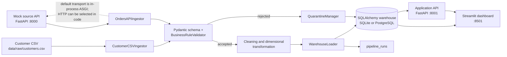
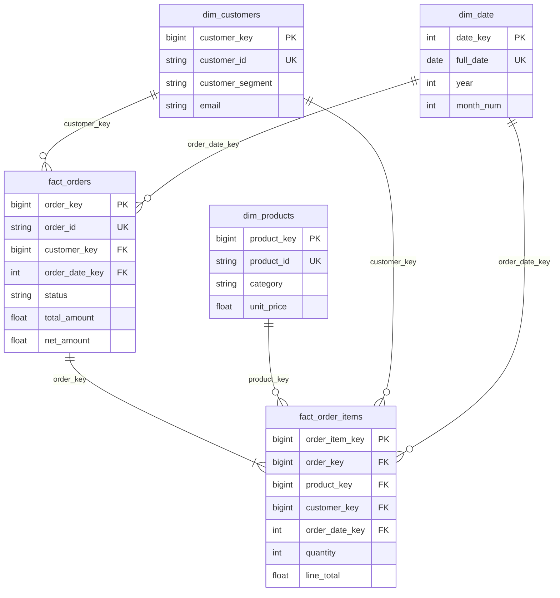

# DataPulse Architecture

## System context

DataPulse is a Python application with two distinct FastAPI services, a pipeline
orchestrator, a relational warehouse, and a Streamlit user interface. The
development default uses SQLite; Docker Compose provisions PostgreSQL 16.

## Component responsibilities

| Component | Responsibility |
|---|---|
| `app/ingestion/csv_ingestion.py` | Reads customer CSV, cleans cell whitespace, adds audit metadata and SHA-256 hash |
| `app/ingestion/api_ingestion.py` | Reads paginated order responses, adds source metadata and payload hashes; supports HTTP and in-process ASGI transport |
| `app/validation/schemas.py` | Pydantic input contracts and syntax/range checks |
| `app/validation/rules.py` | Record-level domain validation and known-customer reference checks |
| `app/validation/engine.py` | Batch validation helpers for duplicates, schema drift and quarantine file output |
| `app/validation/quarantine.py` | Collects rejection records for run-level persistence/export |
| `app/transformation/` | Cleans source attributes, creates dimension rows, facts, and date rows |
| `app/warehouse/loader.py` | Idempotent persistence and batch primary-key prefetch |
| `app/warehouse/models.py` | SQLAlchemy ORM representation of dimensions, facts, and operational tables |
| `app/pipeline.py` | Coordinates ingestion, validation, transformation, warehouse load and run audit |
| `app/api/mock_app.py` | Separate synthetic order-source API |
| `app/api/app.py`, `routes.py`, `services.py` | Warehouse-backed application API, dependency injection, response mapping |
| `dashboard/app.py` | Direct warehouse query and application API dashboard views |

### Service separation

The source API and application API are separate applications and have different
responsibilities:

- **Source API (`app.api.mock_app:app`, port 8000):** synthetic source orders,
  products, health, pagination, and order lookup.
- **Application API (`app.api.app:app`, port 8001):** warehouse health, run
  history, pipeline execution, quality summaries, and analytical endpoints.

`DataPulsePipeline` defaults `force_mock_api_client=True`, so normal local
pipeline runs read the source FastAPI app through an in-process ASGI test
transport. This avoids a required server process and external network. Code can
construct the pipeline with `force_mock_api_client=False` to attempt the
configured HTTP source; the ingestor currently falls back to the local mock
transport when HTTP fetching fails.

## Runtime flow

1. `CustomerCSVIngestor` reads the configured customer file.
2. `OrdersAPIIngestor` retrieves source pages and enriches each order.
3. `DataPulsePipeline` validates each customer and order record using
   `BusinessRuleValidator`. Orders are checked against customer IDs that passed
   customer validation.
4. Invalid results are recorded by `QuarantineManager`. If rejections exist,
   the run exports quarantine data; the records are also sent to the warehouse
   `quarantine_records` table.
5. `DimensionalTransformer` maps accepted source records to warehouse rows.
6. `WarehouseLoader` creates or updates products, customers, dates, order
   headers, and lines inside the database session transaction.
7. The pipeline adds a `PipelineRun` audit row with input, output, rejection,
   and timing information.
8. The dashboard reads warehouse tables and queries the application API for
   health and run actions.

## Warehouse relationships

The model has two business fact grains: one row per order header and one row per
order line. `pipeline_runs` and `quarantine_records` are operational tables, not
sales facts. Full columns and endpoint contracts are documented in
[`DATA_DICTIONARY.md`](DATA_DICTIONARY.md).

## Storage, initialization, and compatibility

- Local SQLite is the default and is created/configured by
  `app/warehouse/connection.py`.
- SQLite enables foreign keys and WAL through engine connection hooks.
- PostgreSQL DDL is in `sql/schema/01_init_warehouse.sql`; Compose mounts it into
  the PostgreSQL first-initialization directory.
- The application API and pipeline call SQLAlchemy `create_all`; this creates
  missing tables but does not migrate existing columns.
- Surrogate keys were expanded from 32-bit to positive 63-bit values. Apply
  `sql/migrations/02_expand_surrogate_keys_to_bigint.sql` to an existing
  PostgreSQL schema before using new keys. Always back up and review a migration
  for the target schema before applying it.

## API surfaces

The application API exposes:

- `GET /health`
- `GET /api/v1/pipeline/runs`
- `GET /api/v1/pipeline/runs/{run_id}`
- `POST /api/v1/pipeline/run`
- `GET /api/v1/quality/summary`
- `GET /api/v1/quality/rejected-records`
- `GET /api/v1/analytics/revenue`
- `GET /api/v1/analytics/top-products`
- `GET /api/v1/analytics/monthly-trends`

The Swagger UI is served at `/docs`. The mock source API exposes a different
contract on port 8000. See [`DATA_DICTIONARY.md`](DATA_DICTIONARY.md).

## Current architectural constraints

- Batch duplicate and unexpected-field detection exists in `validation.engine`,
  but the orchestrator currently loops over `BusinessRuleValidator` rather than
  invoking that batch façade. Treat complete batch-wide duplicate/drift
  enforcement as future integration work.
- The API and dashboard have no authentication or authorization layer in this
  implementation.
- The dashboard connects to the configured warehouse directly as well as
  calling the application API.
- PostgreSQL schema initialization and `create_all` are not a general-purpose
  migration strategy.
