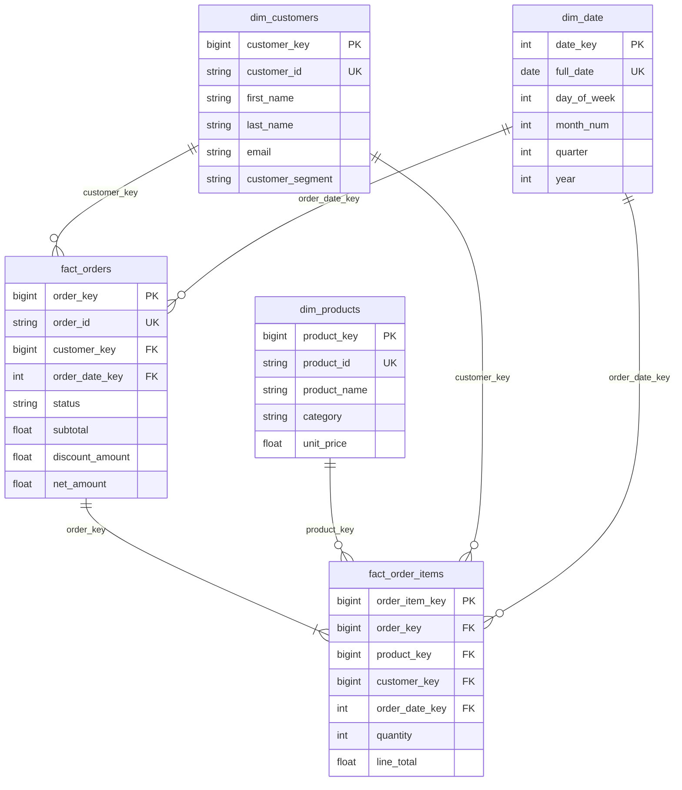

# DataPulse Data Model

The current field-level dictionary and SQLAlchemy types are maintained in
[`DATA_DICTIONARY.md`](DATA_DICTIONARY.md). The diagram below summarizes the
warehouse grains and relationships.

## Fact grains

- `fact_orders`: one row per source order header.
- `fact_order_items`: one row per product line within an order.
- `dim_customers` and `dim_products`: one row per natural entity identifier.
- `dim_date`: one row per calendar date with an integer `YYYYMMDD` key.
- `pipeline_runs` and `quarantine_records` are operational/audit tables and are
  not part of the sales star schema.

Customer, product, order, and order-line surrogate keys use deterministic
positive 63-bit hashes. Earlier 32-bit keys collided in the 50,000-customer
benchmark input. Existing PostgreSQL databases must be upgraded with
[`../sql/migrations/02_expand_surrogate_keys_to_bigint.sql`](../sql/migrations/02_expand_surrogate_keys_to_bigint.sql)
before loading the new key format. Hash collisions remain theoretically
possible, so primary-key constraints remain important.

See the dictionary for field semantics, nullability, API payloads, and response
contracts.
