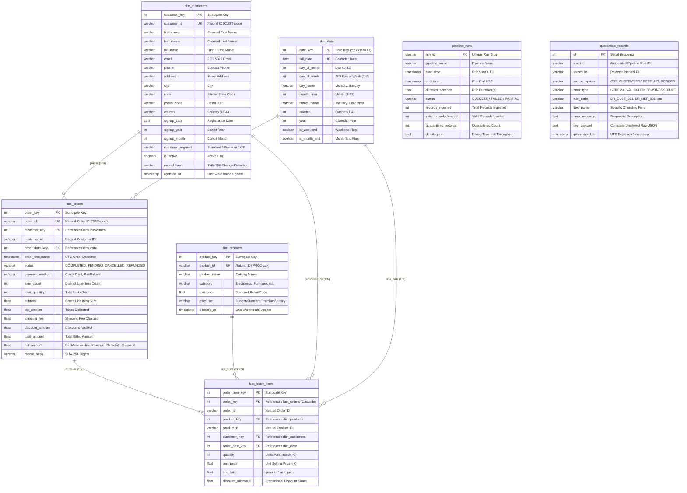

# DataPulse Data Model & Dimensional Warehouse Specification

## 1. Operational Source Schemas

### Source 1: Customer Profiles (CSV)

| Field Name | Source Data Type | Nullable | Description / Business Meaning | Sample Value |
|:---|:---|:---|:---|:---|
| `customer_id` | String | No | Unique natural customer identifier | `"CUST-1001"` |
| `first_name` | String | No | Customer's first given name | `"Alice"` |
| `last_name` | String | No | Customer's family surname | `"Walker"` |
| `email` | String | No | Primary contact email address | `"alice.walker@example.com"` |
| `phone` | String | Yes | E.164 or formatted telephone number | `"+1-555-019-2834"` |
| `address` | String | Yes | Street delivery address | `"123 Innovation Way"` |
| `city` | String | No | City of residence | `"Austin"` |
| `state` | String (2) | No | Two-letter US state abbreviation | `"TX"` |
| `postal_code` | String | No | Postal ZIP code | `"78701"` |
| `country` | String | No | Country of residence (default: USA) | `"USA"` |
| `signup_date` | Date (YYYY-MM-DD)| No | Account registration date | `"2023-04-15"` |
| `customer_segment`| String | No | Account tier: Standard, Premium, VIP | `"Premium"` |
| `is_active` | Boolean | No | Account status flag | `True` |

---

### Source 2: Orders & Transactions (REST API Payload)

**Endpoint:** `GET /api/v1/orders`

```json
{
  "order_id": "ORD-5001",
  "customer_id": "CUST-1001",
  "order_timestamp": "2023-11-20T14:30:00Z",
  "status": "COMPLETED",
  "payment_method": "CREDIT_CARD",
  "subtotal": 249.98,
  "tax_amount": 20.00,
  "shipping_fee": 9.99,
  "discount_amount": 10.00,
  "total_amount": 269.97,
  "items": [
    {
      "item_id": "ITEM-00001",
      "product_id": "PROD-001",
      "product_name": "Pro Wireless Headphones",
      "category": "Electronics",
      "quantity": 1,
      "unit_price": 199.99,
      "line_total": 199.99
    },
    {
      "item_id": "ITEM-00002",
      "product_id": "PROD-006",
      "product_name": "Precision Optical Mouse",
      "category": "Peripherals",
      "quantity": 1,
      "unit_price": 49.99,
      "line_total": 49.99
    }
  ]
}
```

---

## 2. Kimball Star Schema Specification

### Fact Table Grain Definitions:
- **`fact_orders` Grain:** Exactly **one row per customer transaction / order header**. Represents order-level financial aggregates, lifecycle status, payment method, and summary item counts.
- **`fact_order_items` Grain:** Exactly **one row per individual product line item purchased within an order**. Captures item-level quantities, unit prices, extended line amounts, and allocated order-level discounts.

### Surrogate Key Strategy:
- **Technique:** Deterministic positive 32-bit integers derived from SHA-256 digests of natural entity prefixes and IDs:  
  `int.from_bytes(hashlib.sha256(f"{prefix}:{natural_id}".encode()).digest()[:4], "big") % 2147483647`
- **Benefits:**
  1. Decouples the analytical warehouse from operational OLTP natural key changes.
  2. Ensures identical natural keys produce identical surrogate keys across rebuilds without centralized sequence locking.
  3. Fits standard 4-byte indexed integer columns across PostgreSQL and SQLite.

---

## 3. Entity-Relationship (ER) Diagram



---

## 4. Column Definitions, Constraints & Indexes

### Indices & Performance Optimization:
1. **`dim_customers`:**
   - Unique Index: `customer_id`
   - B-Tree Index: `email`
   - B-Tree Index: `state`
   - Composite Index: `(customer_segment, state)`
2. **`dim_products`:**
   - Unique Index: `product_id`
   - B-Tree Index: `category`
3. **`dim_date`:**
   - Unique Index: `full_date`
   - Composite Index: `(year, month_num)`
4. **`fact_orders`:**
   - Unique Index: `order_id`
   - Foreign Key Index: `customer_key`
   - Foreign Key Index: `order_date_key`
   - Composite Index: `(status, order_date_key)`
5. **`fact_order_items`:**
   - Foreign Key Index: `order_key`
   - Foreign Key Index: `product_key`
   - Foreign Key Index: `customer_key`
6. **`quarantine_records`:**
   - B-Tree Index: `rule_code`
   - B-Tree Index: `run_id`
   - B-Tree Index: `source_system`
