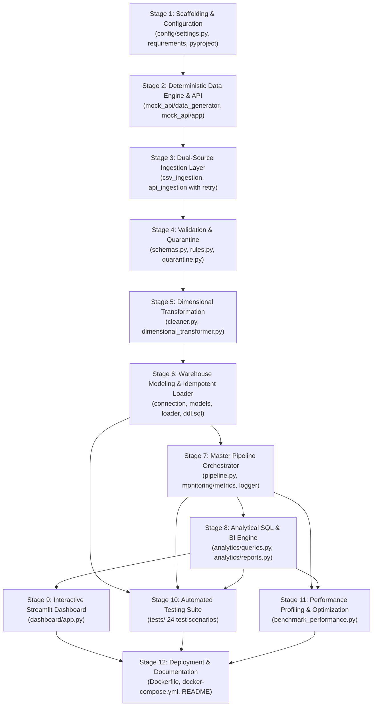

# DataPulse – Technical Implementation & Project Plan

## 1. Business Context to Technical Translation

| Business Need | Data Engineering Challenge | Technical Requirement | Mandatory vs Optional |
|:---|:---|:---|:---|
| **E-Commerce Growth Tracking** | Heterogeneous data sources (CSV files and REST APIs) must be unified. | Implement a dual-source ingestion engine supporting batch CSV parsing and paginated REST API extraction with retry logic. | **Mandatory** |
| **Trustworthy Analytics** | Raw transactional data contains dirty records (missing values, invalid dates, negative amounts). | Enforce two-tier validation: Pydantic V2 schema typing and domain business rules (`BR_CUST_*`, `BR_ORD_*`, `BR_REF_*`). | **Mandatory** |
| **Zero Data Loss** | Invalid records must not be discarded or ignored. | Non-destructive quarantine mechanism recording raw payload, failure reason, rule code, and ingestion timestamp. | **Mandatory** |
| **Fast Business Reporting** | Operational normalized OLTP schemas are slow for analytical aggregations. | Dimensional data warehouse implementing a Kimball Star Schema (`dim_customers`, `dim_products`, `dim_date`, `fact_orders`, `fact_order_items`). | **Mandatory** |
| **Safe Pipeline Reruns** | Pipelines run repeatedly on schedules or retries, risking duplicate counting. | Idempotent upsert/merge logic comparing natural keys and SHA-256 record hashes; duplicate load runs must yield 0 new rows. | **Mandatory** |
| **Operational Governance** | Failures and data quality drift must be auditable. | Execution audit table `pipeline_runs` tracking row counts, durations, and statuses (`SUCCESS`, `FAILED`, `PARTIAL`). | **Mandatory** |
| **Executive Decision Support** | Business stakeholders need RFM, CLV, and MoM trend metrics. | Optimized analytical SQL queries and an interactive multi-tab Streamlit dashboard. | **Mandatory** |
| **Infrastructure Portability** | Evaluators may run locally without Docker or cloud access. | Dual-dialect engine supporting PostgreSQL (via Docker Compose) and SQLite (zero-dependency local fallback). | **Mandatory** |
| **Automated Data Quality Alerts** | Real-time Slack/Webhook alerts on quarantine spike. | Notification dispatcher for quarantine threshold exceedance. | *Optional Enhancement* |
| **CDC / Real-time Streaming** | Continuous real-time stream ingestion. | Kafka / Debezium integration for continuous CDC change streams. | *Optional Enhancement* |

---

## 2. Module Responsibilities Matrix

```
datapulse/
├── config/              # Centralized environment & settings management
├── src/
│   ├── mock_api/        # Source 2 transactional server (FastAPI + synthetic generator)
│   ├── ingestion/       # Extraction modules for CSV and REST API with audit hashing
│   ├── validation/      # Pydantic schemas, business rule validators, quarantine router
│   ├── transformation/  # Data cleansing, surrogate key generation, star schema mapping
│   ├── warehouse/       # SQLAlchemy models, connection pool, idempotent loader, DDL
│   ├── analytics/       # Analytical SQL queries, RFM segmentation, report exporters
│   └── monitoring/      # Structured logging, operational timers, metrics auditing
├── dashboard/           # Streamlit analytics & quarantine monitoring application
├── tests/               # Comprehensive automated Pytest suite (24+ scenarios)
└── scripts/             # Orchestrators (run_all.py, run_pipeline.py, benchmark_performance.py)
```

### Module Boundary Definitions:
1. **`config.settings`**: Immutable runtime settings (paths, database URLs, batch sizes, seeds, timeouts).
2. **`src.mock_api`**: Generates deterministic synthetic data (`seed=42`) with controlled dirty injection (~8%), exposes REST endpoints (`/api/v1/orders`, `/health`, `/api/v1/products`).
3. **`src.ingestion`**:
   - `CustomerCSVIngestor`: Reads CSV chunks, computes SHA-256 hash, attaches ingestion metadata (`_source_system`, `_ingested_at`, `_raw_payload`).
   - `OrdersAPIIngestor`: Queries REST API with pagination, exponential backoff retries, and in-process ASGI fallback.
4. **`src.validation`**:
   - `schemas.py`: Syntactic validation (data types, regex formatting, length constraints).
   - `rules.py`: Semantic domain business rules and cross-entity referential integrity checks (`order.customer_id in valid_customers`).
   - `quarantine.py`: Captures rejected records, writes disk audit files (`.csv`, `.jsonl`), and stages records for database persistence.
5. **`src.transformation`**:
   - `cleaner.py`: String trimming, capitalization, phone/state standardization, ISO UTC normalization.
   - `dimensional_transformer.py`: Generates deterministic integer surrogate keys, expands calendar dates into 11 temporal attributes, maps fact and dimension rows.
6. **`src.warehouse`**:
   - `connection.py`: Engine and session factory with connection pooling and WAL/foreign-key pragma setup.
   - `models.py`: Declarative SQLAlchemy models for dimensions, facts, and audit tables.
   - `loader.py`: ACID transactional loader executing hash-based upsert/merge logic.
   - `ddl.sql`: Standalone production PostgreSQL DDL with indexes and constraints.
7. **`src.analytics`**:
   - `queries.py`: Optimized SQL queries for RFM segmentation, monthly cohort trends, category breakdowns, and CLV.
   - `reports.py`: Formats executive summaries and exports CSV/JSON data assets.
8. **`src.monitoring`**:
   - `logger.py`: Rotating structured console and file logging.
   - `metrics.py`: Phase execution timers, throughput calculation, and data quality pass rate scoring.
9. **`src.pipeline`**:
   - `DataPulsePipeline`: Master orchestrator running extraction -> validation -> quarantine -> transformation -> idempotent load -> audit logging.
10. **`dashboard.app`**:
    - Streamlit web GUI providing interactive exploration of warehouse tables, KPIs, RFM distributions, and quarantine inspector.

---

## 3. Implementation Stages & Dependency Graph



---

## 4. Automated Testing Scenarios Matrix

| Test Suite | Test Function Name | Tested Invariant / Scenario | Target Verification |
|:---|:---|:---|:---|
| **Ingestion** | `test_customer_csv_ingestion_success` | Parses valid CSV rows, attaches SHA-256 hash | Hash length == 64, row counts match |
| **Ingestion** | `test_customer_csv_missing_file_raises` | File missing or path invalid | Raises `CSVIngestionError` explicitly |
| **Ingestion** | `test_orders_api_ingestion_mock_transport` | Paginated API ingestion with in-process ASGI | Multi-page pagination, payload parsing |
| **Validation** | `test_customer_schema_valid` | Valid customer passes Pydantic schema | Schema model valid, types correct |
| **Validation** | `test_customer_schema_invalid_email` | Malformed email string (missing `@` or domain) | Raises Pydantic `ValidationError` |
| **Validation** | `test_customer_schema_future_date_rejected` | Signup date > current date | Raises `ValidationError` |
| **Validation** | `test_business_rule_validator_valid_customer` | Domain validator on clean record | `is_valid == True`, violations empty |
| **Validation** | `test_business_rule_validator_invalid_customer`| Domain validator on dirty record | `is_valid == False`, flags `BR_CUST_*` |
| **Validation** | `test_order_referential_integrity_violation` | Order with non-existent `customer_id` | `is_valid == False`, flags `BR_REF_001` |
| **Validation** | `test_order_negative_amount_violation` | Order with negative financial total | `is_valid == False`, flags `BR_ORD_002` |
| **Validation** | `test_quarantine_manager_logging_and_summary` | Quarantine collection and disk export | Quarantine entry created with raw payload |
| **Transform** | `test_data_cleaner_functions` | Trimming, title-casing, uppercase state | Cleaned string matches expected |
| **Transform** | `test_surrogate_key_generation_deterministic` | Determinism of SHA-256 surrogate key | Same inputs == same key; distinct != distinct |
| **Transform** | `test_build_date_dimension_record` | Date expansion (month end, quarter, day name) | Correct 11 temporal attributes |
| **Transform** | `test_transform_products` | Product catalog mapping & price tiers | Tiers: Budget, Standard, Premium, Luxury |
| **Transform** | `test_transform_orders_and_items` | Star schema mapping for orders & items | Key resolution, discount allocation |
| **Idempotency**| `test_warehouse_loader_idempotency_customers`| Re-loading identical customer batch | Inserts: 1st run=1, 2nd run=0, unchanged=1 |
| **Idempotency**| `test_warehouse_loader_update_changed_record` | Loading modified record with changed hash | Updates row, no duplicate inserted |
| **Analytics** | `test_analytical_executive_kpis` | Scorecard aggregate query execution | Correct keys, non-null totals |
| **Analytics** | `test_analytical_rfm_segmentation` | RFM window calculations & segment labels | Valid segment names, non-empty df |
| **Analytics** | `test_analytical_monthly_trends` | MoM growth and monthly metrics | Sequential months, MoM growth % |
| **Analytics** | `test_analytical_top_products` | Top 5 products by net sales | Sorted descending by net_sales |
| **Analytics** | `test_analytical_category_breakdown` | Category sales aggregation | Grouped by category, non-negative totals |
| **End-to-End** | `test_end_to_end_pipeline_execution` | Full pipeline execution lifecycle | Status SUCCESS, tables populated, audit row |
