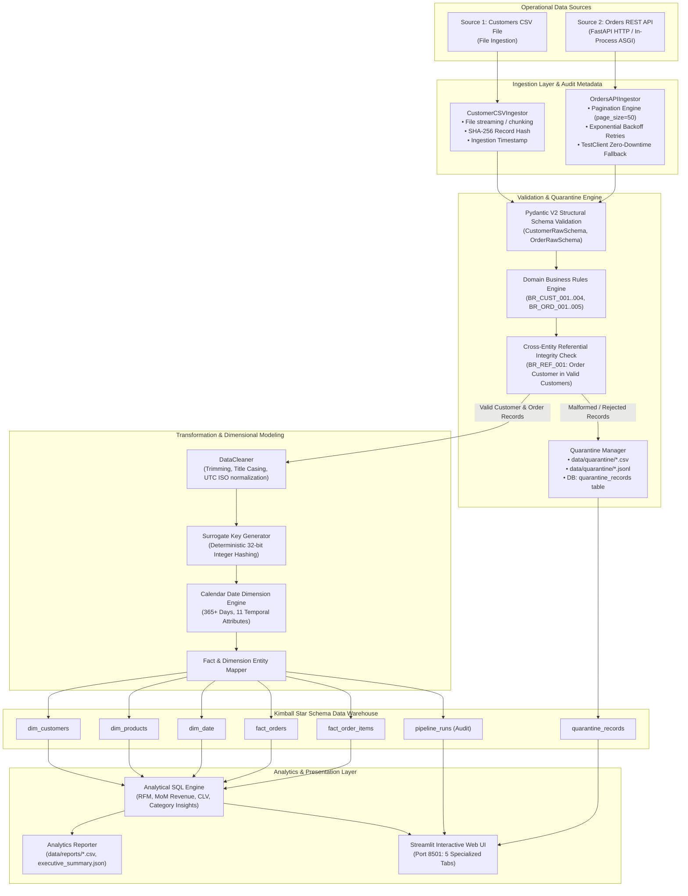
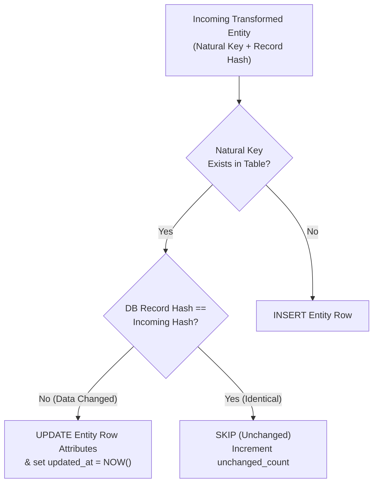

# DataPulse Platform Architecture Specification

## 1. High-Level Architecture Overview

DataPulse is an idempotent, decoupled ELT data engineering platform. It ingests customer demographic batches and paginated transactional order streams, validates every record against structural and domain rules, stages invalid records in an auditable quarantine repository, transforms clean data into a Kimball Star Schema warehouse, and powers executive business intelligence.



---

## 2. Ingestion Protocols, Pagination & Retry Resilience

### Source 1: Customers CSV File
- **Protocol:** Local filesystem file stream with UTF-8-sig encoding support (stripping BOM headers).
- **Audit Traceability:** Each row is enriched with:
  - `_source_system`: Literal `"CSV_CUSTOMERS"`
  - `_source_file`: Base filename (e.g. `customers.csv`)
  - `_source_row_num`: Sequential file line number
  - `_ingested_at`: UTC ISO timestamp
  - `_record_hash`: SHA-256 digest of normalized payload
  - `_raw_payload`: Unaltered serialized JSON string

### Source 2: Orders REST API
- **Protocol:** HTTP/1.1 REST (`GET /api/v1/orders`) with query parameters:
  - `page`: 1-based page index
  - `page_size`: default 50 records per page (up to 500)
- **Pagination Strategy:** Deterministic multi-page consumer that reads `total_pages` from the response payload and iterates sequentially until exhaustion or `max_pages` limit.
- **Retry with Exponential Backoff:**
  - Configurable retry attempts (`RETRY_ATTEMPTS=3`).
  - Delay calculation: `delay = backoff_factor * (2 ** (attempt - 1))`.
  - Catches transient network errors, socket timeouts, and HTTP 5xx codes.
- **In-Process ASGI Zero-Downtime Fallback:**
  - If the standalone HTTP server is offline or unreachable during CLI/test execution, `OrdersAPIIngestor` immediately switches to an in-process FastAPI `TestClient(app)` transport without network overhead or port conflicts.

---

## 3. Non-Destructive Error Handling & Quarantine Architecture

```
Raw Record Ingested
       │
       ▼
Pydantic Schema Validation ──(Invalid)──► Collect Syntax Violations
       │ (Valid)                               │
       ▼                                       │
Domain Business Rules       ──(Invalid)──► Collect Semantic Violations
       │ (Valid)                               │
       ▼                                       │
Cross-Entity Integrity Check──(Invalid)──► Collect Referential Violations
       │ (Valid)                               │
       │                                       ▼
       │                          QuarantineManager.record_quarantine()
       │                                       │
       │                                       ├─► Append to in-memory audit log
       │                                       ├─► Persist to data/quarantine/*.csv
       │                                       ├─► Persist to data/quarantine/*.jsonl
       │                                       └─► Stage for DB quarantine_records table
       ▼
Safe for Star Schema Transformation & Loading
```

### Quarantine Invariants:
1. **Never Silently Discard:** Every invalid record must be recorded.
2. **Payload Preservation:** Full unaltered raw input is retained in `raw_payload` for root-cause debugging.
3. **Structured Attribution:** Violations contain `rule_code` (e.g., `BR_CUST_001`), `field_name`, `error_type`, and descriptive message.
4. **Dual Persistence:** Stored both on disk (CSV/JSONL for archival) and in the database warehouse (`quarantine_records` table for dashboard queries).

---

## 4. Idempotency & Upsert Strategy

To ensure that scheduled pipeline executions or manual reruns produce the exact same warehouse state without data duplication:



### ACID Transaction Boundary:
All database operations for a pipeline run execute within a single SQLAlchemy transaction (`with get_db_session() as session:`). If any unexpected error occurs, the session is rolled back completely, guaranteeing zero partial states.

---

## 5. Observability, Logging & Pipeline Health Metrics

### Structured Logging:
- Standard format: `[YYYY-MM-DD HH:MM:SS] [LEVEL] [LOGGER_NAME] Message`
- Multi-target output:
  - Console `sys.stdout` for interactive CLI feedback
  - File `logs/datapulse_pipeline.log` for persistent troubleshooting

### Pipeline Execution Auditing (`pipeline_runs` Table):
- `run_id`: Unique run identifier (e.g., `DP-20261030-075101-ce65f4`).
- `pipeline_name`: Literal `"datapulse_ecommerce_pipeline"`.
- `start_time` / `end_time`: UTC timestamps.
- `duration_seconds`: Total runtime in seconds.
- `status`: Execution status (`SUCCESS`, `FAILED`, `PARTIAL`).
- `records_ingested`: Sum of all input records.
- `valid_records_loaded`: Clean dimensional records loaded.
- `quarantined_records`: Count of records routed to quarantine.
- `details_json`: Detailed metrics breakdown including phase timers and throughput (records/second).
